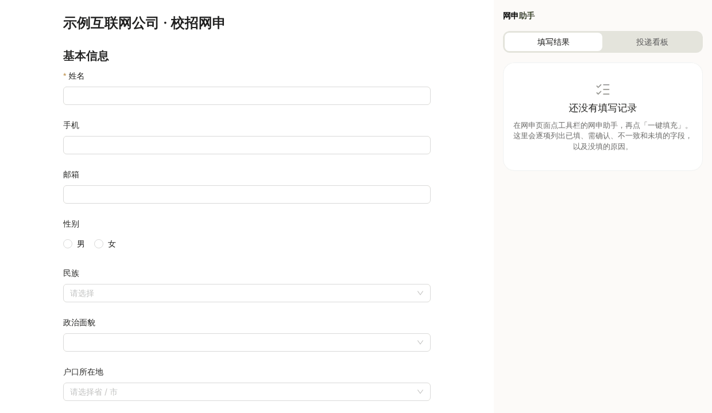

# 网申助手

Edge / Chrome 浏览器插件：在国内校招、社招网申页面一键填写本地档案，清楚标出哪些填了、哪些需要确认、哪些没填及原因。**只填不交**，检查后由你自己提交。



> 当前进度：阶段 4（MVP）。完整计划见 [docs/PLAN.md](docs/PLAN.md)，设计规范见 [design/](design/)。

## 能做什么

- **个人档案**：基本信息、求职意向、教育 / 实习 / 项目 / 校园经历、获奖、语言证书、家庭成员等，可按岗位方向存多份。
- **从简历导入**：选 PDF 或 Word 简历，本机识别姓名、学校、经历等，预览后另存为新档案。简历不上传。
- **一键填写**：在网申页点插件图标 →「一键填充」。已适配北森、Moka，也能处理常见的原生表单、Ant Design、Element Plus 页面。
- **填写结果**：侧边栏逐项列出已填、需要确认、不一致和没填的字段及原因；点一项在页面上定位；可一键撤销。
- **投递看板**：自己提交后记一条（公司、岗位、链接、所用档案），状态可改为笔试、面试、offer 等，可导出 Excel 能打开的表格。
- **导出为简历**：把档案排成一页简历，选导出哪些部分，存成 PDF 或复制文字。身份证号、籍贯、家庭成员等不会导出。
- **AI 助手**：选一家国内大模型（DeepSeek、通义千问、智谱、Kimi、豆包、硅基流动、腾讯混元、百度千帆），只填 API Key，在 AI 助手页右上角「设置」里填。可以简历诊断、经历润色、岗位分析、写网申问答题，或者直接「问 AI」，插件自动挑合适的技能回答。见 [docs/AI技能清单.md](docs/AI技能清单.md)。
- **备份**：档案和投递记录导出成一个文件，换电脑时导入。

## 同学安装（不用写代码）

1. 拿到打包好的 `edge-mv3` 文件夹（Chrome 用 `chrome-mv3`）。
2. Edge 地址栏输入 `edge://extensions`（Chrome 输入 `chrome://extensions`），打开「开发人员模式」。
3. 点「加载解压缩的扩展」，选这个文件夹。
4. 点工具栏的拼图图标，把「网申助手」固定出来；第一次先点它 →「设置」，建档案或从简历导入。

手机号、邮箱、身份证号默认不会自动填写，需要的话在档案里逐项打开开关。

## 开发

需要 Node.js 20 或更高版本。

```bash
npm install          # 安装依赖（会自动生成 .wxt 类型）
npm run dev          # 打开一个装好插件的 Chrome，改代码自动重载
npm run dev:edge     # 同上，用 Edge
npm run build        # 打包到 .output/chrome-mv3
npm run build:edge   # 打包到 .output/edge-mv3
npm run compile      # TypeScript 类型检查
npm test             # 单元测试（Vitest），含原生测试表单的识别率
npm run fixtures     # 构建测试表单（原生 / Ant Design / Element Plus）到 tests/fixtures/dist
npm run test:e2e     # 端到端测试：在 Chromium 里加载插件，填写测试表单、导入简历、记投递看板
npm run demo         # 重新生成 docs/demo.gif（需要 ffmpeg）
```

第一次跑端到端测试前，先运行 `npx playwright install chromium` 下载测试用浏览器。

### 测试表单与识别率

`tests/fixtures/forms/` 下有三张测试表单，每个字段外层用 `data-expect` 标出正确的档案路径（`none` 表示不该填）。测试会统计：识别正确、认错（最危险，必须为 0）、没认出、不该填却认出。

| 表单 | 模拟 | 识别 |
|---|---|---|
| native.html | 老式表单（表格布局、无 for 的 label、只有 placeholder） | 38/38 |
| antd.html | Moka 一类 React + Ant Design 页面 | 17/17 |
| element.html | 北森一类 Vue + Element Plus 页面 | 20/20 |

这些是自制页面，词典是对着它们写的，数字只说明流程跑通。

### 真实页面快照

`tests/fixtures/forms/real/` 是真实网申页面保存下来的快照（已去掉脚本、其他插件的界面和个人信息），同样用 `data-expect` 标出正确答案：

| 快照 | 系统 | 适配前 | 适配后 |
|---|---|---|---|
| moka-danone.html | Moka | 7/22 | 23/23 |
| beisen-zhuanzhuan.html | 北森 | 5/13 | 14/14 |

目前每个系统只有一页，计划书要求各 3 页以上，样本还不够。下拉框的弹出选项不在快照里，已在真页面上人工确认能选上。新增快照：在网申页按 Ctrl+S 保存“网页，全部”，去敏后放进这个目录并标好 `data-expect`。

### 简历识别

`tests/fixtures/resumes/` 是三份虚构简历（三种常见写法），以及由它们生成的 PDF、Word 版本，测试会逐项核对识别结果。

### 手动加载

1. 运行 `npm run build`（或 `npm run build:edge`）。
2. Chrome 打开 `chrome://extensions`，Edge 打开 `edge://extensions`，打开"开发者模式"。
3. 点"加载已解压的扩展程序"，选 `.output/chrome-mv3`（Edge 选 `.output/edge-mv3`，两者都能用）。

## 结构

```
entrypoints/
  popup/        点击工具栏图标弹出：识别当前页、切换档案
  sidepanel/    侧边栏：填写结果、投递看板
  options/      档案编辑、从简历或备份导入、导出、AI 助手
  resume/       导出简历（A4 预览、打印成 PDF）
  background.ts 用户点击后把 content script 注入当前页，转发消息
  content.ts    在网申页面里扫描、填写（运行时注入，不常驻）
src/
  lib/profile/  档案结构、存储、导入导出
  lib/fill/     字段识别（detect）、词典（aliases）、匹配（match）、填写回读与撤销（fill）、页面标色（marks）、只填不交（safety）
  lib/resume/   简历读文字（extract：pdf.js / mammoth）、按行拼接（lines）、识别成档案（parse）
  lib/tracker/  投递看板记录、CSV 导出、从页面猜公司和岗位
  lib/ai/       服务商、调用、去敏、技能（skills/、chatSkills）、自动选技能（router）
  lib/          其他与界面无关的逻辑
  components/   共用 React 组件
  styles/       tokens.css（设计规范的唯一来源）+ base.css
tests/          单元测试；fixtures/ 测试表单；e2e/ 端到端测试
design/         设计规范、tokens 原稿、组件示例页
docs/PLAN.md    完整计划书
```

## 原则

- 只填不交：不点击提交、保存、下一步。
- 宁可不填，不填错；写入后回读校验。
- 档案只存在本机浏览器；只申请 `activeTab`，不申请"读取所有网站"。
- 不识别、不绕过验证码和风控，不保存网站账号密码。
- AI 功能由你点击才调用，只请求你选的那一家服务商；发送前去掉姓名、电话、邮箱、身份证号、家庭成员等个人信息。

## 许可

MIT
