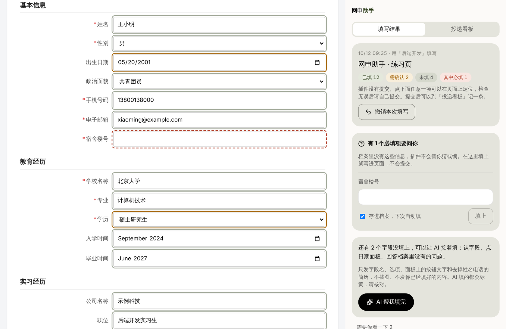
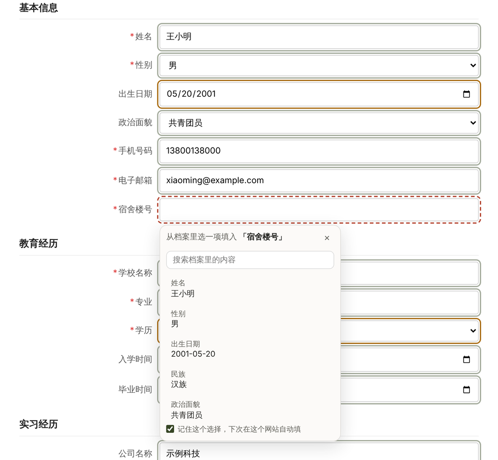
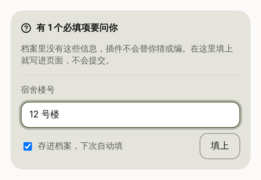
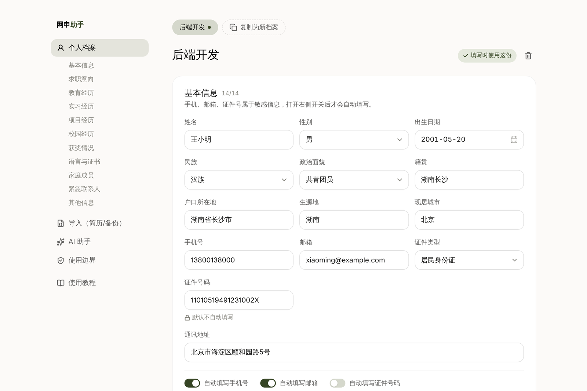
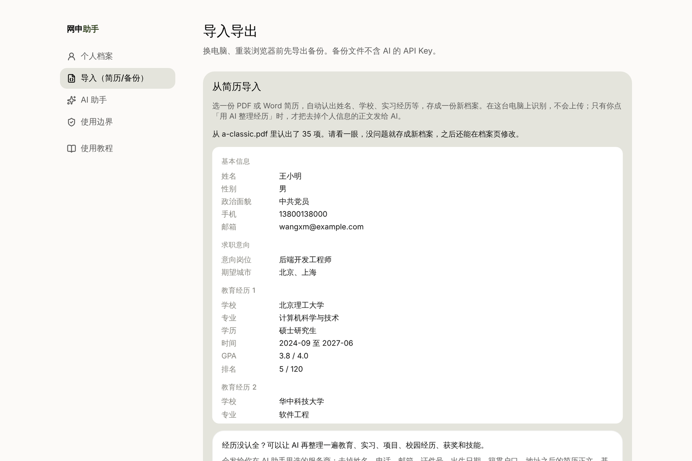
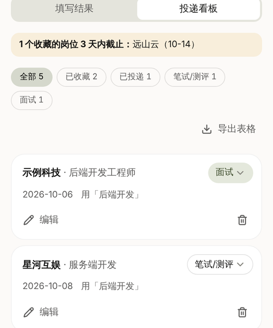
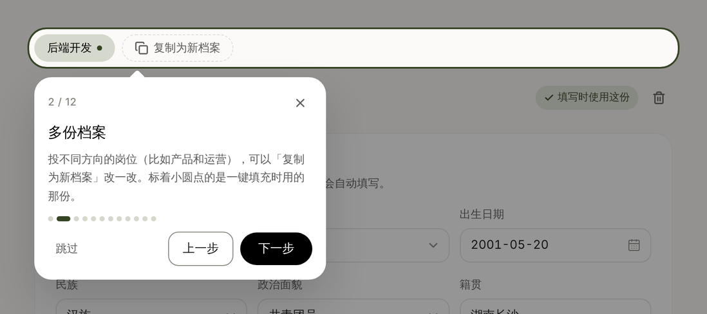
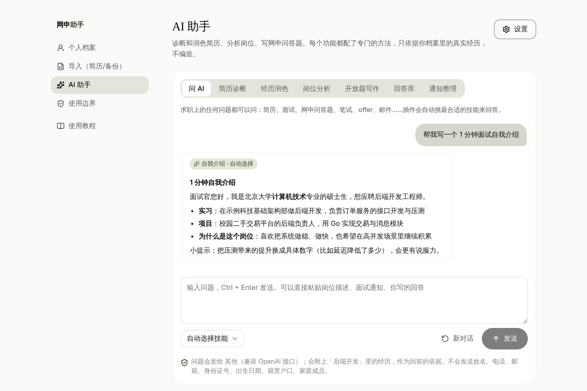
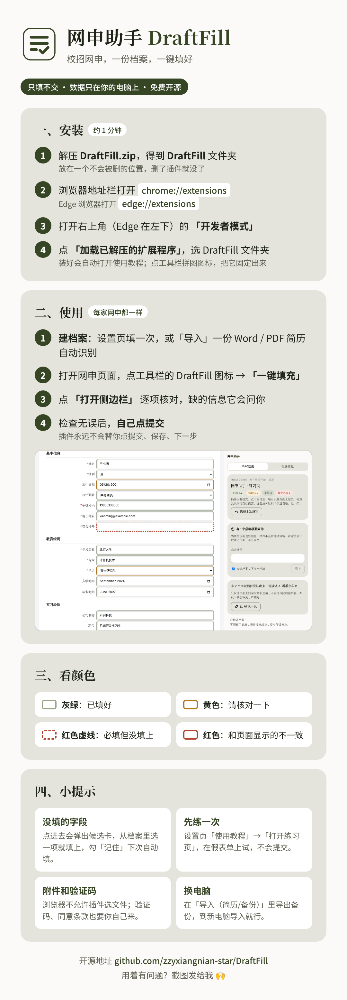

<div align="center">


# 网申助手 DraftFill

**校招网申，一份档案，一键填好。只填不交，最后一步永远由你确认。**

一个 Chrome / Edge 浏览器插件：在北森、Moka、飞书招聘、Wecruit 等网申页面上，把你的个人档案一键填进表单，<br>
并清楚标出哪些填好了、哪些要你核对、哪些没填以及为什么。

[](#安装)
[](#安装)
[](#隐私与边界)
[](#开发)
[](LICENSE)

[功能](#功能) · [安装](#安装) · [怎么用](#怎么用) · [隐私与边界](#隐私与边界) · [已适配的网申系统](#已适配的网申系统) · [常见问题](#常见问题) · [开发](#开发)

<br>



<sub>点一下「一键填充」：绿色边框是填好的，黄色请你核对，红色虚线是必填但还空着。侧边栏逐项列出结果和原因。</sub>

</div>

<br>

## 为什么做这个

秋招一个人要投几十家，每家网申都要把姓名、学校、GPA、实习经历、获奖、家庭成员重新填一遍。已有的自动填表工具要么只认英文表单，要么填错了也不告诉你。

DraftFill 的思路是：**认得准的帮你填，认不准的宁可不填，并告诉你为什么。** 网申填错一个字段的代价远大于多花十秒自己填。

<br>

## 功能

### 一键填充，结果一目了然

在网申页点插件图标 →「一键填充」。填完每个字段都标了颜色，侧边栏按“必填还空着 / 需要你看一下 / 已填写 / 没有填写”分组，写明每一项的原因，点一项就定位到页面上的字段。不满意可以一键撤销。

<table>
<tr>
<td width="50%" valign="top">

### 候选卡：没认出的点一下就填

插件没填的字段，点进去旁边会列出档案里能填的内容，点一下填上。勾「记住」，同一个网站下次自动填。

</td>
<td width="50%" valign="top">

### 缺什么问什么，不替你编

必填、但档案里没有的字段（比如宿舍楼号），侧边栏会逐个问你。你答了才写进页面，勾上「存进档案」下次直接填。

</td>
</tr>
<tr>
<td valign="top"></td>
<td valign="top" align="center"></td>
</tr>
<tr>
<td valign="top">

### 个人档案，填一次到处用

按网申常见栏目分好：基本信息、求职意向、教育、实习、项目、校园、获奖、语言证书、家庭成员、紧急联系人，还能自定义「其他信息」。投不同方向可以存多份档案。

</td>
<td valign="top">

### 从简历导入

选一份 PDF 或 Word 简历，在本机认出姓名、学校、经历、奖项等，预览确认后存成档案。简历不上传。

</td>
</tr>
<tr>
<td valign="top"></td>
<td valign="top"></td>
</tr>
<tr>
<td valign="top">

### 投递看板和截止提醒

在招聘页「收藏这个岗位」，自动摘下岗位名和截止日期。提交后记一条，跟进笔试、面试、offer。3 天内截止的会在工具栏图标上显示数字，可导出表格。

</td>
<td valign="top">

### 上手有导览

第一次安装自动打开使用教程。「开始导览」逐页高亮讲解每个功能，还有一张练习用的假网申表单，可以放心试。

</td>
</tr>
<tr>
<td valign="top" align="center"></td>
<td valign="top"></td>
</tr>
<tr>
<td colspan="2" valign="top">

### AI 助手（可选）

填上国内大模型的 API Key（DeepSeek、通义千问、智谱、Kimi、豆包、硅基流动、腾讯混元、百度千帆，或任何兼容 OpenAI 接口的服务），可以简历诊断、经历润色（STAR）、岗位匹配分析、写网申问答题（严格控字数）、整理笔试面试通知成日历文件，或者直接提问，插件自动挑合适的技能回答。

发给 AI 之前会去掉姓名、电话、邮箱、证件号、家庭成员。AI 不知道的数字和细节会标成【待补充】让你补，不替你编。**不用 AI 也完全不影响填表。**

<p align="center"></p>

</td>
</tr>
</table>

**还有这些：**

- **多段经历**：档案里的经历比页面多时，自动点「添加」补出段落再填
- **省市区级联、学校专业模糊匹配**：「华科」也能对上「华中科技大学」，模糊匹配的一律标黄请你核对
- **常用回答库**：写过的好回答存起来，遇到相似的网申问答题直接取用，也能让 AI 按新题改写
- **多步表单**：点了「下一步」出现新字段，侧边栏会提示再填一次，已经填过的不会被覆盖
- **导出为简历**：把档案排成一页简历，存成 PDF
- **备份**：档案、投递记录、回答库导出成一个文件，换电脑时导入

<br>

## 安装

> 目前还没有上架应用商店，需要手动加载，一分钟就好。

**[⬇ 下载 DraftFill.zip](https://github.com/zzyxiangnian-star/DraftFill/raw/main/release/DraftFill.zip)**（Chrome、Edge 通用，压缩包里附了一张安装使用教程图）

1. 解压，得到 `DraftFill` 文件夹，放在一个不会被删的位置。
2. 浏览器地址栏打开 `chrome://extensions`（Edge 是 `edge://extensions`），打开「开发者模式」。
3. 点「加载已解压的扩展程序」，选择 `DraftFill` 文件夹。
4. 点工具栏的拼图图标，把「网申助手 DraftFill」固定出来。

装好后会自动打开使用教程。

<details>
<summary><b>安装使用教程卡片（可以直接转发给同学）</b></summary>
<br>
<p align="center"></p>
</details>

## 怎么用

1. **建档案**：在设置页「个人档案」里填一次，或者「导入」里选一份简历自动识别。
2. **打开网申页面**，点工具栏的 DraftFill 图标 →「一键填充」。
3. **打开侧边栏核对**：黄色的看一下，红色虚线的补上，附件和验证码自己来。
4. **检查无误后，自己点提交。**

第一次用可以先在教程里点「打开练习页」，在假表单上完整走一遍，不会提交到任何地方。

<br>

## 隐私与边界

这些是写死在代码里的原则，不是可选项：

| | |
|---|---|
| **只填不交** | 插件从不点击提交、保存、下一步类按钮。所有程序化点击都经过同一个安全检查。 |
| **宁可不填，不填错** | 认不准就不填并写明原因；写入后回读校验；模糊匹配、AI 结果一律标黄。 |
| **数据只在本机** | 档案只存在你自己的浏览器里，没有服务器，没有统计上报。 |
| **最小权限** | 只用 `activeTab`：你点了图标，插件才读当前这一页，不申请“读取所有网站”。 |
| **敏感信息默认不填** | 手机号、邮箱、证件号、家庭成员默认不自动填，在档案里逐项打开才填。 |
| **不碰验证码** | 不识别、不绕过验证码和滑块，不保存网站账号密码。 |
| **AI 由你触发** | 只在你点击时调用你选的那一家；填表时只发字段名和选项，不发档案内容。 |

<br>

## 已适配的网申系统

用真实网申页面的快照（已去掉个人信息）做测试，每个字段都标了正确答案：

| 系统 | 典型公司 | 快照识别 |
|---|---|---|
| 北森 | 转转等 | 14 / 14 |
| Moka | 达能等 | 23 / 23 |
| 飞书招聘 | 沐瞳等 | 9 / 9 |
| Wecruit（hotjob） | 华润电力等 | 32 / 32 |
| 原生表单、Ant Design、Element Plus | 各类自建网申 | 自制测试表单全部识别 |

每个系统目前只有一两个页面的样本，**欢迎提交更多网申页面的快照**（见[参与贡献](#参与贡献)）。大易（dayee）等系统还没有样本。

<br>

## 常见问题

<details>
<summary><b>为什么有的字段没填？</b></summary>

插件认不准就不填，宁可漏填也不填错。侧边栏里每一项都写了原因；点进字段可以从候选卡里选一项填上，勾「记住」后同一网站下次自动填。
</details>

<details>
<summary><b>能帮我自动提交、批量投递吗？</b></summary>

不能，这是故意的。网申是一次性的，填错了很难改；自动海投也违反大多数招聘网站的规则。DraftFill 只帮你省掉重复填写的时间，最后的检查和提交由你来。
</details>

<details>
<summary><b>我的档案存在哪里？换电脑怎么办？</b></summary>

存在浏览器的扩展本地存储里，只在这台电脑上。换电脑前在「导入（简历/备份）」里导出备份，到新电脑导入即可。备份文件含个人信息，不要发到群里。
</details>

<details>
<summary><b>点图标没反应 / 提示“不是网页”？</b></summary>

浏览器自己的页面（设置页、新标签页、应用商店）插件读不了，换到网申网站上再点。
</details>

<details>
<summary><b>AI 功能要钱吗？</b></summary>

插件本身免费。AI 功能用的是你自己在服务商那里申请的 API Key，按服务商的价格计费；国内几家都有免费额度。不填 Key 也能正常使用填表、候选卡、回答库等全部非 AI 功能。
</details>

<br>

## 开发

需要 Node.js 20 或更高版本。技术栈：[WXT](https://wxt.dev) + Manifest V3 + React 19 + TypeScript，测试用 Vitest 和 Playwright。

```bash
npm install          # 安装依赖
npm run dev          # 打开一个装好插件的 Chrome，改代码自动重载（dev:edge 用 Edge）
npm run build        # 打包到 .output/chrome-mv3（build:edge 打包 Edge 版）
npm run compile      # TypeScript 类型检查
npm test             # 单元测试（Vitest），含测试表单的识别率
npm run test:e2e     # 端到端测试：在 Chromium 里加载插件，填测试表单、导入简历、走一遍导览
npm run screens      # 重新生成 README 截图（需要 ffmpeg）
npm run experiment   # 对照实验：规则、字段记忆、LLM 兜底各补了多少
```

第一次跑端到端测试前，先运行 `npx playwright install chromium`。

<details>
<summary><b>项目结构</b></summary>

```
entrypoints/
  popup/        点击工具栏图标弹出：一键填充、收藏岗位、切换档案
  sidepanel/    侧边栏：填写结果、缺信息询问、AI 认字段、投递看板
  options/      设置页：档案、导入导出、AI 助手、使用边界、使用教程和导览
  practice/     练习用的假网申表单
  resume/       导出简历（A4 预览、打印成 PDF）
  background.ts 用户点击后把 content script 注入当前页，转发消息
  content.ts    在网申页面里扫描、填写（运行时注入，不常驻）
src/lib/
  fill/         字段识别（detect）、词典（aliases）、匹配（match）、填写回读与撤销（fill）、只填不交（safety）
  profile/      档案结构、兼容旧数据（normalize）、导入导出
  resume/       简历读文字（pdf.js / mammoth）、识别成档案
  answers/      常用回答库
  tracker/      投递看板、截止提醒、日历文件
  ai/           服务商、调用、去敏、技能与自动选技能
tests/          单元测试；fixtures/ 测试表单、真实页面快照、虚构简历；e2e/ 端到端测试
docs/           计划书、AI 技能清单、对照实验报告
```
</details>

<details>
<summary><b>识别率怎么测的</b></summary>

`tests/fixtures/forms/` 下的测试表单和真实页面快照，每个字段外层用 `data-expect` 标出正确的档案路径（`none` 表示不该填）。测试统计：识别正确、**认错（必须为 0）**、没认出、不该填却认出（必须为 0）。

规则、字段记忆、LLM 兜底各自的贡献见 [对照实验报告](docs/实验报告.md)：规则是主力；在没见过的网站上，主要损失是控件没被发现，记忆和 LLM 只能补“发现了但没认出”的那一小部分。
</details>

### 参与贡献

最有帮助的是**真实网申页面的快照**：在网申页按 `Ctrl+S` 保存“网页，全部”，把里面你自己的信息删掉或换成虚构的，开一个 Issue 附上，并说明是哪家公司、哪个系统。也欢迎反馈填错、没认出的字段（截图即可）。

提交代码前请跑 `npm test` 和 `npm run test:e2e`。新增字段叫法改 `src/lib/fill/aliases.ts`，并在测试表单里加对应字段。

<br>

## 许可

[MIT](LICENSE)。本项目与文中提到的任何招聘系统、公司均无关联；示例数据全部是虚构的。
